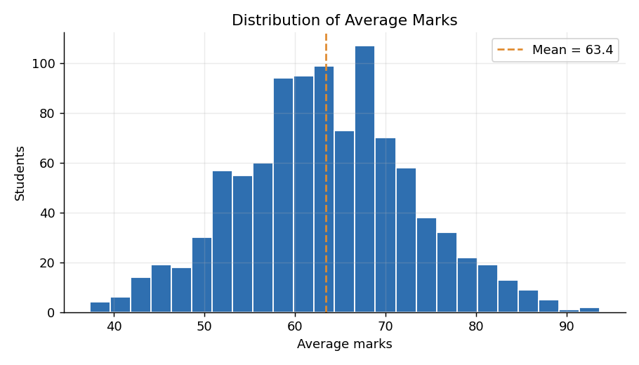
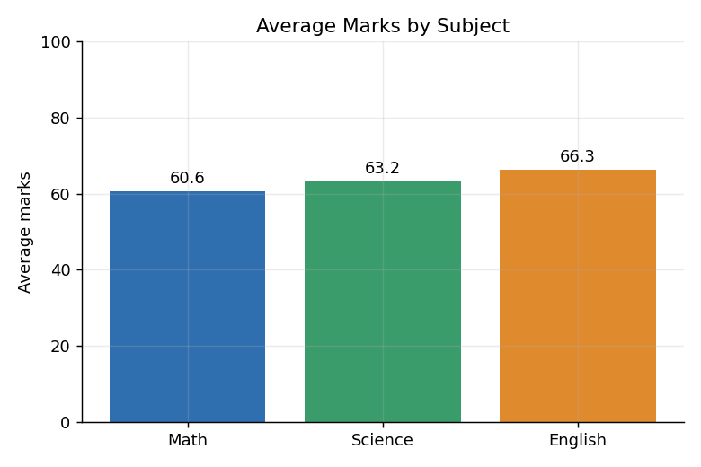
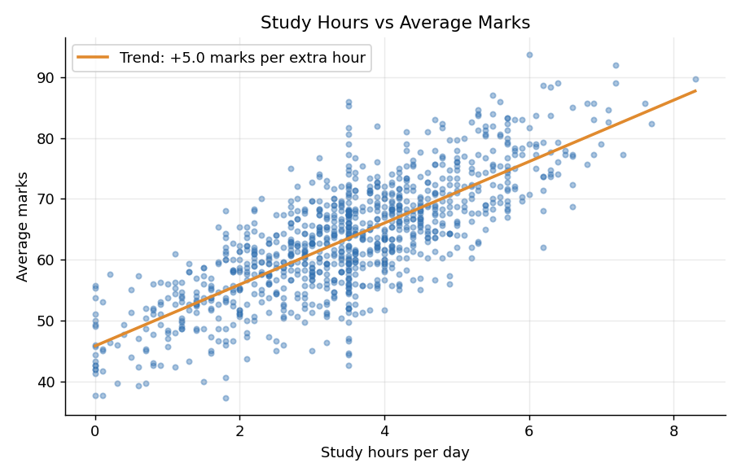
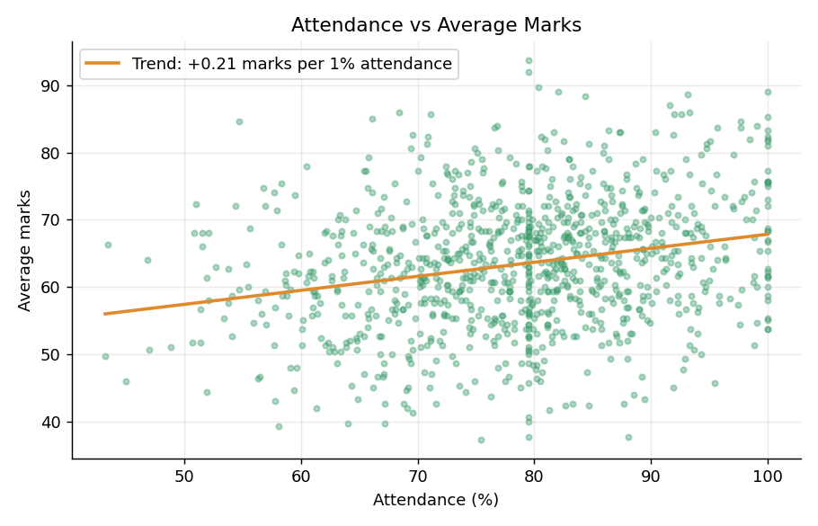
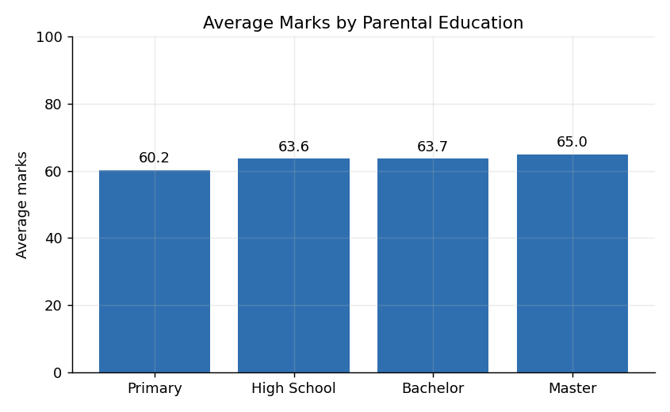
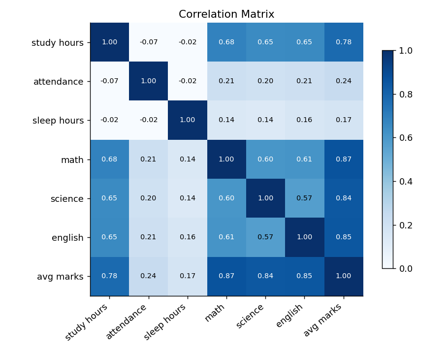
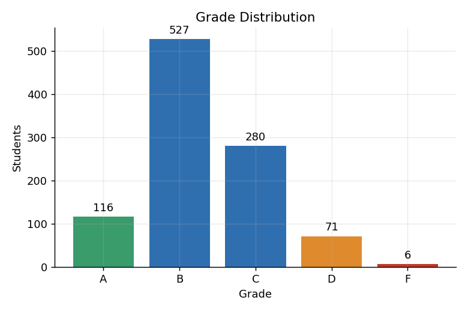

# Student Performance Analysis Using Python

**Tech:** Python, Pandas, NumPy, Matplotlib

Cleaned and analysed a student performance dataset to find which factors most affect academic results, and visualised marks and performance trends.

> **Note:** The dataset is **synthetic** (generated by `generate_data.py`) so the project is self-contained and shareable. You can swap in any real CSV with similar columns (e.g. the Kaggle "Students Performance in Exams" dataset) by adjusting column names in `analysis.py`.

## Project structure

```
├── generate_data.py        # builds the messy raw dataset
├── analysis.py             # cleaning + analysis + charts
├── student_data_raw.csv    # raw data (1,025 rows, with duplicates/missing/invalid values)
├── student_data_clean.csv  # cleaned data (1,000 rows)
├── analysis_output.txt     # printed results of the analysis
└── charts/                 # 7 visualisations
```

## How to run

```bash
pip install pandas numpy matplotlib
python generate_data.py
python analysis.py
```

## Data cleaning (Pandas + NumPy)

| Issue | Count | Fix |
|---|---|---|
| Duplicate records | 25 | `drop_duplicates()` |
| Inconsistent labels (`M`, `male`, ` Female `, `Y`, `yes`...) | gender, internet access, parental education | strip / lowercase / map to standard values |
| Invalid values (marks outside 0-100, attendance outside 0-100) | 8 marks, 5 attendance | set to NaN, then imputed |
| Missing values | 263 cells (after removing invalid) | median for numeric, mode for categorical |

Result: **1,025 raw records → 1,000 clean records**, zero missing values.

## Key findings

- **Study hours is the strongest factor** (correlation with average marks = **0.78**). Students studying 6+ hours/day average **79.2** vs **51.8** for those studying under 2 hours (a gap of ~27 marks).
- **Attendance helps, more modestly** (r = 0.25): students with 90%+ attendance average 67.6 vs 59.5 for those under 60%.
- **Sleep** has a weak positive link (r = 0.17).
- **Extra classes** add about **2.5 marks** on average (64.9 vs 62.4).
- **Parental education:** students whose parents only completed primary school average 60.2 vs ~64-65 for others.
- **Gender and internet access** show almost no difference (< 0.5 marks).
- **English** has the highest average (66.3) and **Math** the lowest (60.6).
- **Grades:** 52.7% of students scored a B, 11.6% an A, 0.6% an F.

## Visualisations

| | |
|---|---|
|  |  |
|  |  |
|  |  |
|  | |


